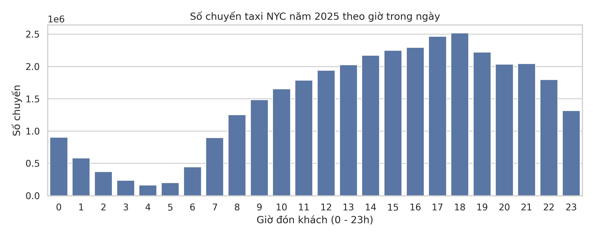
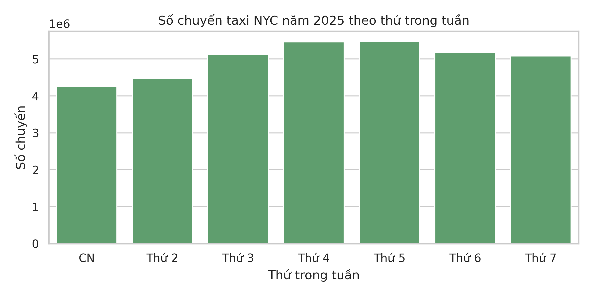
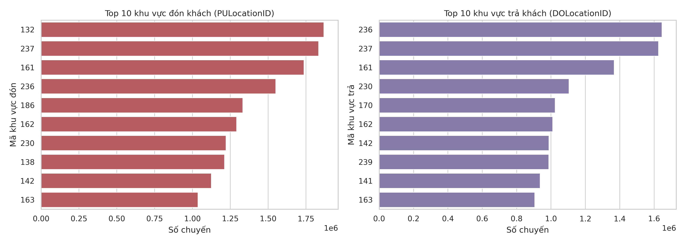
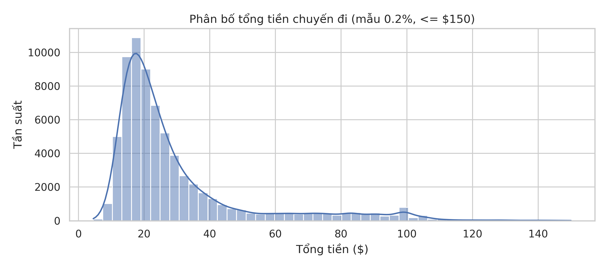

# Phân tích dữ liệu NYC Yellow Taxi 2025 bằng PySpark

## 1. Tổng quan dự án
Dự án thực hiện tiền xử lý, làm sạch dữ liệu và phân tích mô tả dữ liệu chuyến đi **NYC Yellow Taxi năm 2025** trên **Google Colab** sử dụng **PySpark**, sau đó trực quan hóa kết quả bằng **Pandas**, **Matplotlib** và **Seaborn**.

- **Notebook chính:** `Untitled12.ipynb`
- **Nền tảng chạy:** Google Colab + Google Drive + PySpark (`SparkSession`)
- **Định dạng lưu trữ dữ liệu sạch:** Apache Parquet (`taxi_clean_2025`, gồm 12 phân vùng)

---

## 2. Quy mô dữ liệu trước và sau làm sạch (Năm 2025)
Dữ liệu được lọc qua **7 quy tắc** (loại bỏ `NULL` trên 10 cột bắt buộc, yêu cầu `tpep_dropoff_datetime > tpep_pickup_datetime`, `0 < trip_distance < 100`, `1 <= passenger_count <= 6`, `0 < total_amount < 500`, `tip_amount >= 0`, `fare_amount > 0`):

| Chỉ số | Số lượng bản ghi | Tỷ lệ | Ghi chú |
| :--- | :---: | :---: | :--- |
| **Dữ liệu thô ban đầu (12 tháng năm 2025)** | `48.722.602` | `100,00%` | Gộp từ 12 tệp `yellow_tripdata_2025-01` đến `2025-12` |
| **Dữ liệu sạch giữ lại** | `35.074.288` | `71,99%` | Đạt toàn bộ điều kiện lọc, lưu tại `taxi_clean_2025` |
| **Dữ liệu nhiễu / ngoại lai bị loại bỏ** | `13.648.314` | `28,01%` | Bị loại do thiếu giá trị hoặc giá trị bất hợp lý |

---

## 3. Luồng xử lý trong Notebook
1. **Kết nối & Khởi tạo (`Cell 1`):** Cài đặt `pyspark`, `matplotlib`, `seaborn`; gắn Google Drive; khởi tạo `SparkSession` (`NYCTaxi_Huyen_Clean`, `spark.sql.shuffle.partitions = 64`) và liệt kê các tệp `.parquet`.
2. **Làm sạch dữ liệu & Lưu bản sạch (`Cell 2`):** Chọn đúng 12 tệp năm 2025, trích xuất 10 cột cần thiết, ép kiểu dữ liệu (`timestamp`, `int`, `double`), lọc nhiễu và ghi ra `taxi_clean_2025`.
3. **Nạp dữ liệu sạch để phân tích (`Cell 3`):** Khởi tạo phiên phân tích (`NYCTaxi_Analysis_ML`), đọc lại `taxi_clean_2025` và kiểm tra cấu trúc (`printSchema()`).
4. **Tổng hợp & Trực quan hóa (`Cell 4`):** Tính toán theo giờ đón, thứ trong tuần, Top 10 khu vực đón/trả và phân bố giá vé, sau đó xuất 4 ảnh PNG (300 DPI) vào thư mục `outputs/`.

---

## 4. Kết quả trực quan hóa

### 4.1. Số chuyến theo giờ đón khách

### 4.2. Số chuyến theo thứ trong tuần

### 4.3. Top 10 khu vực đón và trả khách nhiều nhất

### 4.4. Phân bố tổng tiền chuyến đi (mẫu 0,2%, total_amount <= 150$)

